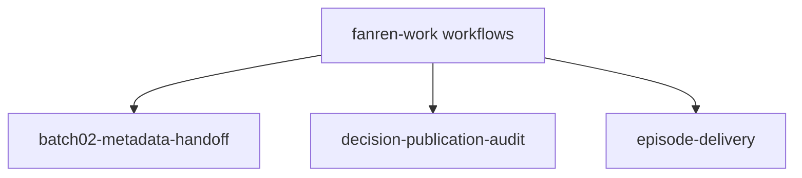
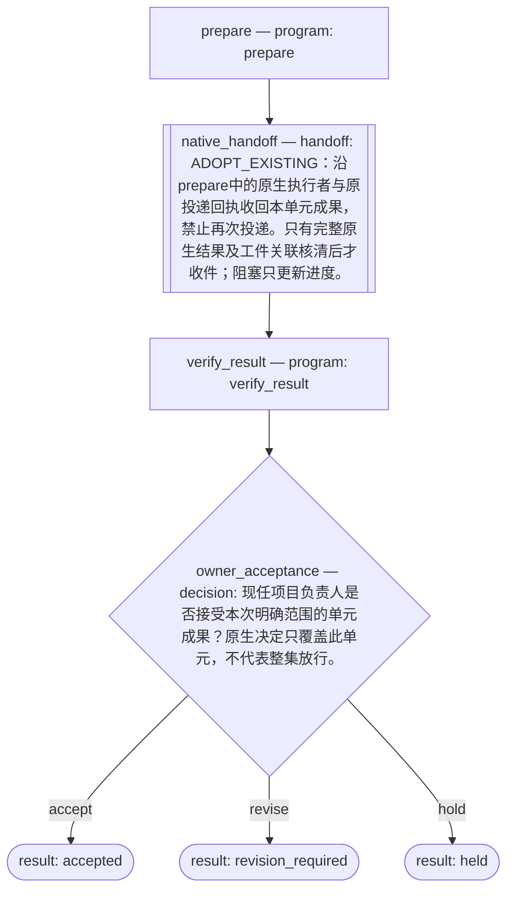
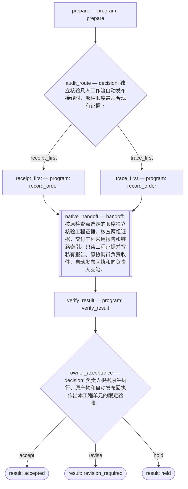

# 项目工作流

负责人选择任务单元、输入与核收条件，程序执行明确步骤，成果沿原任务交给接手方。实时进展查 [Issue #2](https://github.com/CF-FE/fanren-work/issues/2) 与 [Project #5](https://github.com/orgs/CF-FE/projects/5?pane=issue&itemId=285760278)。

<!-- workflow-index:start -->
## 工作流索引



总览连线表示项目包含这些流程，不表示流程间存在依赖。

- [batch02-metadata-handoff](#batch02-metadata-handoff)
- [decision-publication-audit](#decision-publication-audit)
- [episode-delivery](#episode-delivery)
<!-- workflow-index:end -->

<!-- workflow:batch02-metadata-handoff:start -->
## batch02-metadata-handoff

[步骤图、数据接口与运行方式](batch02-metadata-handoff/README.md) · [项目共同入口](../README.md)

把已有 batch02 封存回执核成逐行指纹索引，再将真实输出交下一单元整理，最终交现任项目负责人核收本次元数据流程的采用范围。
<!-- workflow:batch02-metadata-handoff:end -->

集合入口及各流程源码由本项目独立维护。元数据流程保留 d7f5573 初始化基线；首集后续单元使用固定版本 36e23b4 初始化。新增或修改流程时，同步维护图与说明。


<!-- workflow:episode-delivery:start -->
## episode-delivery



- 用途与步骤：见上图；从 `prepare` 开始。
- 输入：`--input` JSON；字段由本流程的 program 操作定义。
- 输出：状态 JSON 的 `outputs`、`decisions`、`action` 和执行检查点。
- 职责与收件合同：[首集后续单元](episode-delivery/README.md)。原 Herdr 协调员承接原动作，现任项目负责人决定本单元成果；实时进展沿上方原 Issue / Project。
- 项目共同记忆：[阅读入口](../README.md)。
- 源码：[definition.py](episode-delivery/definition.py) · [workflow.py](episode-delivery/workflow.py)。

从项目根使用项目接续入口（输入、结果及检查点均在仓库外）：

```sh
python3 scripts/episode_delivery.py --state "$STATE" init --input "$INPUT"
python3 scripts/episode_delivery.py --state "$STATE" status
python3 scripts/episode_delivery.py --state "$STATE" collect --manifest "$RESULT"
python3 scripts/episode_delivery.py --state "$STATE" decide --record "$OWNER_DECISION"
```

程序处置完成和业务通过分列；`HELD`、`REVISION_REQUIRED` 均为未验收。新的实际制作沿负责人明确的依赖、范围和预算建立后继单元，保留原动作与成果引用。
<!-- workflow:episode-delivery:end -->

首集领域依赖和Q/R/P/C节点沿[领域定义](episode08-01-continuation/definition.json)及[运行接续说明](episode08-01-continuation/README.md)维护；实际单元在私有registry绑定固定源码与检查点，准备结果不代表整集验收。


<!-- workflow:decision-publication-audit:start -->
## decision-publication-audit



- 用途与步骤：见上图；从 `prepare` 开始。
- 输入：`--input` JSON；字段由本流程的 program 操作定义。
- 输出：状态 JSON 的 `outputs`、`decisions`、`action` 和执行检查点。
- 责任岗位、接手方及实时 Issue / Project：由项目在本块外补充；规格未定义。
- 项目共同记忆：[阅读入口](../README.md)。
- 源码：[definition.py](decision-publication-audit/definition.py) · [workflow.py](decision-publication-audit/workflow.py)。

从项目根目录运行（检查点存放在仓库外私有绝对路径；替换原任务与输入）：

```bash
RUN="$(mktemp -d /tmp/project-workflow.XXXXXX)/run.sqlite3"
python3 workflows/decision-publication-audit/workflow.py --state "$RUN" start --task TASK --input input.json
python3 workflows/decision-publication-audit/workflow.py --state "$RUN" status
```
<!-- workflow:decision-publication-audit:end -->
