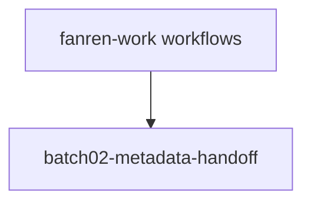

# 项目工作流

负责人选择任务单元、输入与核收条件，程序执行明确步骤，成果沿原任务交给接手方。实时进展查 [Issue #2](https://github.com/CF-FE/fanren-work/issues/2) 与 [Project #5](https://github.com/orgs/CF-FE/projects/5?pane=issue&itemId=285760278)。

<!-- workflow-index:start -->
## 工作流索引

总览连线表示项目包含该流程；后续跨流程依赖按实际交接维护。

- [batch02-metadata-handoff](#batch02-metadata-handoff)
<!-- workflow-index:end -->

<!-- workflow:batch02-metadata-handoff:start -->
## batch02-metadata-handoff

[步骤图、数据接口与运行方式](batch02-metadata-handoff/README.md) · [项目共同入口](../README.md)

把已有 batch02 封存回执核成逐行指纹索引，再将真实输出交下一单元整理，最终交现任项目负责人核收本次元数据流程的采用范围。
<!-- workflow:batch02-metadata-handoff:end -->

集合入口及各流程源码由本项目独立维护。当前流程使用已发布的协调仓生成工具 d7f5573 初始化；本入口按负责人选择手工维护。新增或修改流程时，同步维护图与说明。
