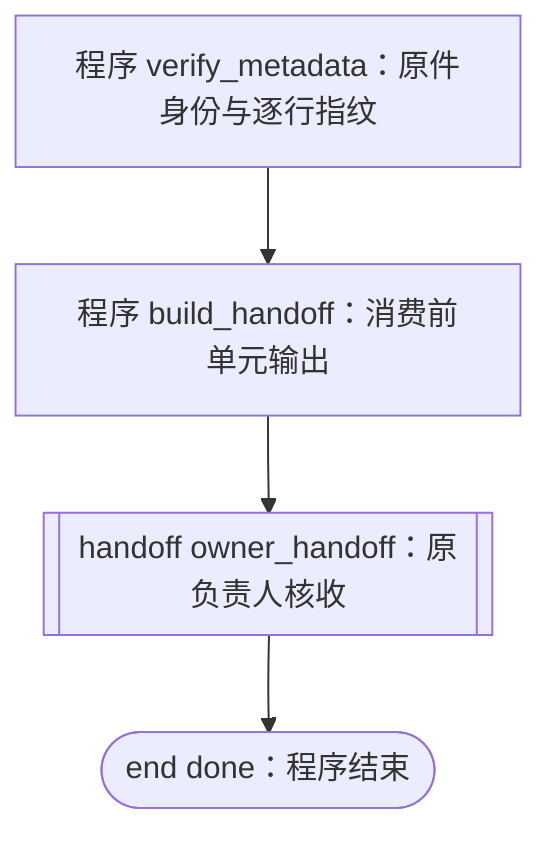

# batch02-metadata-handoff

用途：核实既有 batch02 封存 JSON 身份与 86 行索引，将第一单元的真实输出交第二单元整理成技术引用及遗留主题交接包，再交现任项目负责人核收。



图的边来自 [definition.py](definition.py) 中四个步骤的 `next`。两单元由现有宿主程序顺序执行，现任项目负责人接收成果并决定采用范围。两个程序单元与负责人交接属于本次覆盖；音频质量和整集交付沿原任务继续。

| 单元 | 输入与前置 | 成果与接手方 |
| --- | --- | --- |
| `verify_metadata` | 私有 `completion_path` 指向已有封存回执；`prior_acceptance_ref` 指向既有技术核收 | 文件字节数、SHA-256、86 行 JSON 指纹及索引摘要，交 `build_handoff` |
| `build_handoff` | `run["outputs"]["verify_metadata"]`；使用前一步的 source、row_count、row_index、row_index_sha256 和任务引用 | 技术引用回执、逐行索引、遗留审定主题，交原负责人 |
| `owner_handoff` | 同次运行的两单元输出、检查点和证据引用 | 等待原负责人的实际接收与采用决定，之后导入同一动作的回执 |

第一单元只读取封存 JSON；第二单元使用已保存的第一单元输出。原回执的技术、听审、业务验收和附加审计状态保留各自依据。本流程核收范围是元数据身份、索引及交接。

## 运行

Python 3.10+ 标准库即可。源码归本项目维护，运行时读取相邻 `definition.py`，无需协调仓。生成来源为 [herdr-4-codexcloud PR #11](https://github.com/CF-FE/herdr-4-codexcloud/pull/11) 的固定源码 `d7f55732e42b72fc14cdbd7776e337004c774c7a`。

私有输入保存在仓库外，形状为：

```json
{
  "completion_path": "/absolute/private/completion.json",
  "prior_acceptance_ref": "fanren-issue2-batch02-1706-owner-decision-20261104/terminal-owner-review"
}
```

从项目根运行，将输入位置和原任务替换为实际值：

```bash
RUN="$(mktemp -d /tmp/fanren-metadata.XXXXXX)/run.sqlite3"
python3 workflows/batch02-metadata-handoff/workflow.py --state "$RUN" start --task ORIGINAL_TASK --input /absolute/private/input.json
python3 workflows/batch02-metadata-handoff/workflow.py --state "$RUN" status
```

两单元完成后停在 `WAITING_RECEIPT`。把真实输出与当前动作交原负责人；取得其原生核收回执后，由受信执行者导入并继续：

```bash
python3 workflows/batch02-metadata-handoff/workflow.py --state "$RUN" receive --action ACTION_ID --status COLLECTED --evidence NATIVE_OWNER_RECEIPT
python3 workflows/batch02-metadata-handoff/workflow.py --state "$RUN" resume
```

恢复使用本次原源码、输入和检查点；`status` 只读当前状态。运行 JSON 的 `outputs.verify_metadata`、`outputs.build_handoff`、`action` 及检查点共同保存交接关联。`FINISHED` 记录程序技术结束，业务采用另以负责人的实际决定为准。

共同记忆与规则沿[项目 README](../../README.md)进入。当前进展：[Issue #2](https://github.com/CF-FE/fanren-work/issues/2) · [Project #5](https://github.com/orgs/CF-FE/projects/5?pane=issue&itemId=285760278)。
