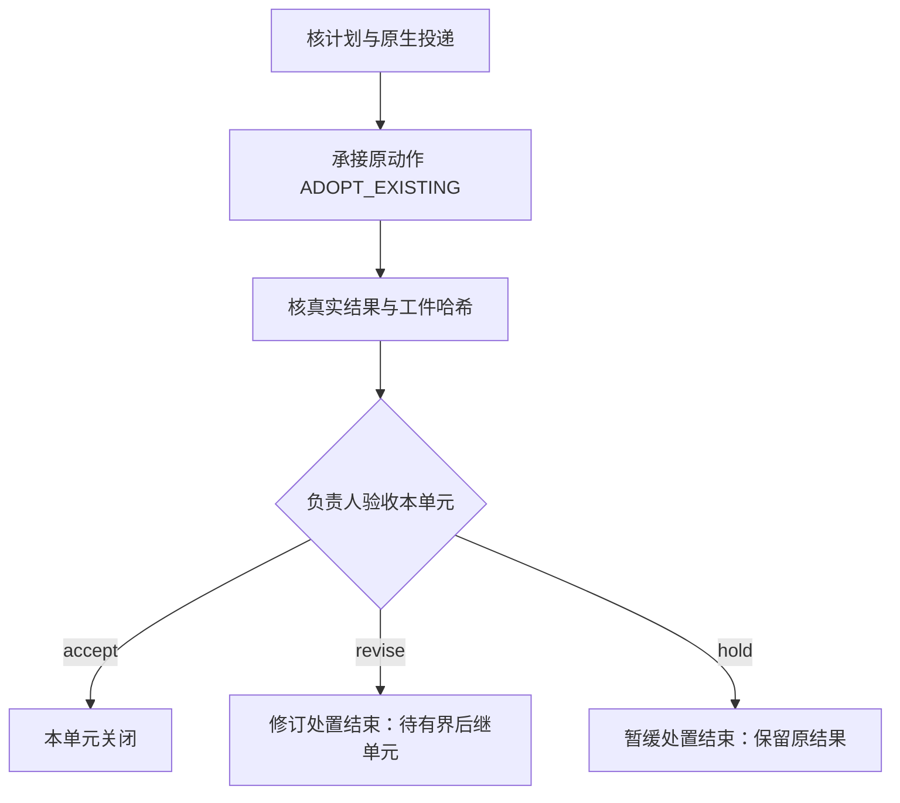

# 首集后续单元工作流

同一项目定义用于各个独立单元，任务值由现任项目负责人的实际计划输入。每个单元有独立且稳定的 `task_id` 和私有 SQLite 检查点；仅换数据库路径不能避免动作 ID 冲突。



首轮单元是音频感知能力核实、角色素材对账和后期素材接收计划，均不是音频质量放行或整集完成。封面采用记录作为后期输入；已完成的元数据与第二批生产保留原状态和证据，不恢复旧检查点、不重做成功片段。

## 唯一执行入口

原 Herdr 协调员负责原生投递、核实身份、取回成果与负责人决定。这个项目脚本只做本地准备、原生回执绑定、核收和检查点推进，没有 Herdr、网络、模型或音频生成调用。旧跟进项在责任实际交接后保留为当前检查点的唤醒／观察入口，不再独立派发。

每次醒来，协调员先 `status`；处于 `native_handoff` 时沿输入中的原生线程及投递回执收件。已受理任务用 `ADOPT_EXISTING` 接续，不能再次发送提示。遇到 UNKNOWN、局部阻塞或延期，保留原动作并对账。负责人尚未决定时本单元持续等待；负责人作出暂缓或修订决定后由原协调员明确后继与下一复查。后续实际制作需要负责人给出新的范围、依赖、预算及唯一执行者，再以新稳定任务 ID 建单元。

## 命令

从本仓运行，`STATE`、输入和原始结果均在仓库外的私有目录：

```sh
python3 scripts/episode_delivery.py --state "$STATE" init --input "$INPUT"
python3 scripts/episode_delivery.py --state "$STATE" status
python3 scripts/episode_delivery.py --state "$STATE" collect --manifest "$RESULT"
python3 scripts/episode_delivery.py --state "$STATE" decide --record "$OWNER_DECISION"
```

`status` 只读检查点且不加载项目操作。`init` 同任务同输入幂等，不产生新投递。`ADOPT_EXISTING` 只接原动作；`PREPARE_NEW` 先输出稳定handoff，原协调员实际派发一次后使用 `bind --record` 绑定原生回执，之后才能收件。新模式不能填已有投递或伪造回执。`collect` 核实际原生 final 和本地工件后才导入原动作的 `COLLECTED`，停到 `owner_acceptance`。`PARTIAL`、`BLOCKED`、`UNKNOWN` 保存私有原文快照与最新进度指针，`status` 重启后仍可见阻塞和原件哈希，不改成成功收件；进入验收后不再以旧进度覆盖当前状态。

`decide` 只接受现任负责人同一单元、同一结果哈希的原生决定。`accept` 只验收本单元；`revise` 或 `hold` 将本单元以 `REVISION_REQUIRED` 或 `HELD` 处置关闭，`business_accepted=false`，不重跑旧动作。程序的 `FINISHED` 仅说明该有限单元已完成处置，不代表交付通过。新方案或修订须沿原引用创建明确后继单元，保留未决在途状态。

## 私有数据接口

工件引用统一为 `{ "path": "绝对本地路径", "bytes": 123, "sha256": "64位小写摘要" }`。输入包含：

| 字段 | 含义 |
| --- | --- |
| `schema_version`, `project` | `1`、`fanren-work` |
| `contact_ref`, `task_id`, `unit_id` | 原交办、稳定单元任务、单元名称 |
| `owner_plan` | 已核负责人的原文工件引用 |
| `mode` | `ADOPT_EXISTING`（兼容默认值）或 `PREPARE_NEW` |
| `native_turn_id` | 仅接续已有动作时必填；原生业务回合与同一执行线程和原交办关联 |
| `dispatch_binding_path` | 新单元的仓外固定回执绑定文件；init时还没有投递 |
| `executor` | `name/session/pane/thread` 显式原生身份 |
| `acceptor` | 负责人的同一身份结构及 `generation` |
| `existing_dispatch` | 仅接续已有动作时必填；Herdr prompt 原始返回工件，要求 `exit_code=0`、`result.type=agent_prompted` 和实际名称／窗格一致 |
| `due_at` | 含时区的负责人交期；不据此伪称停止或取消 |
| `scope`, `inputs`, `deliverable_kind`, `deliverables` | 明确操作边界、输入和本单元交付物 |
| `prior_refs` | 原任务、完成证据和封面采用等关联 |
| `result_manifest_path` | 仓库外固定结果文件，保存后禁止不同字节覆盖 |

结果 JSON 包含 `schema_version=1`、同一 `task_id/unit_id/executor/deliverable_kind`、工作流产生的 `action_id`、`status`、`summary`。`DELIVERED` 还必须给出非空 `artifacts` 工件引用列表、`native_turn_id` 和 `native_receipt`。后者可为 `source_kind=codex_app_read_thread` 的真实 `read_thread` 结构化结果（历史无source_kind也按此类型），或由本仓 `scripts/native_receipt.py` 从已绑定Codex原生JSONL提取的 `source_kind=codex_transcript_snapshot.v1`。两者要求 `thread.id` 与执行者一致、指定 turn 与冻结输入一致、其中原始 userMessage 包含 `contact_ref`，并存在非空 `agentMessage`／`phase=final`（宿主也返回 `final_answer`）；准备中 commentary 或回显不能代替结果。

负责人原生 final 须包含 JSON 决定条目（可在 `decisions` 列表内），明确 `task_id/unit_id/result_sha256/choice`；不接受同线程其他任务旧回复或互相冲突的决定。负责人决定 JSON 包含 `schema_version=1`、同一 `task_id/unit_id`、`owner`（与 `acceptor` 完全一致）、`choice=accept|revise|hold`、已保存结果的 `result_sha256`、`native_turn_id` 和对应的 `native_receipt` 工件。

这些检查验证关联及字节完整性，不是身份认证或语义判断。原协调员须先核工具来源和真实身份，确认原文确实作出该决定再导入；任意本地 JSON 不能自行取得验收权。工件被修改、来源缺失或源代码签名不一致时停止推进，保留原检查点并沿原任务核清。

## 运行与维护

`workflow.py` 从协调工具固定版本 `36e23b4df6046773931d8d8d7f060e3552e80398` 复制；它由本仓独立维护，没有跨仓导入。业务操作在 `definition.py`，接续入口在 `scripts/episode_delivery.py`。项目入口自身 SHA 也记录到检查点，收件与决定前核对。收件提交哈希与恢复读取原件必须一致；首次决定前复核相关输入和成果字节，已记相同决定仅幂等读回。运行开始后源码与输入冻结，修改用于新的明确单元，旧检查点仍由其原版本读取。

运行资料保存在仓库外，源代码、接口说明和测试在本仓维护。不要提交机器身份、实际私有路径、原始会话、音频或凭据。修改后运行：

```sh
python3 -m unittest discover -s tests -p 'test_episode_delivery.py' -v
```

## 新单元制单与原生回执

新单元输入设置 `mode=PREPARE_NEW` 与 `dispatch_binding_path`，不提供 `existing_dispatch/native_turn_id`。执行 `init` 后的稳定 `action.id` 是原协调员唯一派发意图的关联键；未绑定时返回 `UNBOUND_NEEDS_RECONCILIATION`、`dispatch_required=null`，不会把缺文件认定为未派出。先沿原协调员意图账与同一原生动作核实；确认没有既有投递后先记录原意图，再派发一次。`requires_native_binding=true` 只说明需核原生办理，不表示获得额外权限。原协调员须把 `native_request_marker` 的任务ID与动作ID两行原样纳入真正发送的任务正文；bind/collect均核同回合原user标记，禁止混用同worker的旧阶段。实际原生投递后，绑定记录包括 `schema_version=1`、相同 `task_id/unit_id/action_id/executor`、真实 `native_turn_id` 、原生 `dispatch_receipt` 工件引用及该回合原user的 `native_request` 工件引用：

```sh
python3 scripts/episode_delivery.py --state "$STATE" bind --record "$NATIVE_BINDING"
```

同字节绑定可幂等读回，不同内容不能覆盖。`bind` 不推进COLLECTED；只在当前handoff保存原生投递关联。原生请求超时但结果未知时先沿原动作查账，不能因为本地尚无binding就重发。

原生协调员无需桌面导出会话：

```sh
python3 scripts/native_receipt.py --transcript "$BOUND_CODEX_JSONL" \
  --thread "$BOUND_THREAD" --turn "$BUSINESS_TURN" --contact-ref "$CONTACT_REF" \
  --output "$NEW_PRIVATE_NATIVE_SNAPSHOT"
```

提取器核 `session_meta`、`task_started/turn_context`、同回合的原交办文本、真实final及 `task_complete`，只保存原user/final，并记录来源路径、观察字节数/哈希、时点和行号；不导出分析内容。完成事件会省略末尾记忆渲染引用，比较时仅去掉该尾块，快照仍保留原final。原件只读，输出不同内容不覆盖；新观察使用新的私有文件。快照是明确标注的本地原生证据，不伪装成桌面工具返回。

派发后尚未完成时，可使用同一提取命令加 `--request-only`，生成明确标记 `codex_transcript_request.v1` 的请求快照用于 `bind`；它不包含final、不作为成果收件。源回合正文必须真实含本单元的两个固定标记，外层JSON声明不能替代它。
