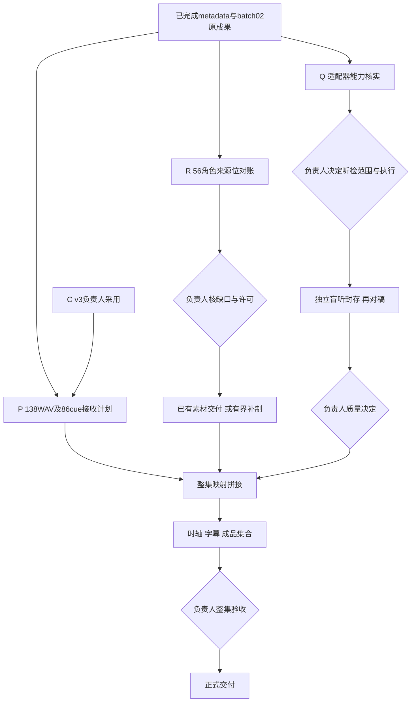

# episode08-01-continuation

现任负责人决定的首集领域工作流。它把 Q／R／P／C 节点映射到共用 [episode-delivery 单元执行器](../episode-delivery/README.md) 的独立运行，不另建调度引擎。真实输入、执行者、交期、结果与原跟进项映射在仓库外私有 registry 中维护；进展沿 [Issue #2](https://github.com/CF-FE/fanren-work/issues/2)、[封面 Issue #5](https://github.com/CF-FE/fanren-work/issues/5) 和 [Project #5](https://github.com/orgs/CF-FE/projects/5)。



节点与依赖保存在[领域定义](definition.json)，图按同一领域关系维护；它不被当作新调度引擎执行。图中业务依赖由原协调员沿实际结果与负责人决定释放。当前准备单元完成不代表听检、角色补制或整集成品完成。部分阻塞只影响对应节点；不得凭没有找到记录就把全部角色音频判成确证缺失。

| 节点 | 初始单元类型 | 后继的释放条件 |
| --- | --- | --- |
| Q | `audio_capability_report` | 负责人明确新 attempt、适配范围、写域与资源守卫后建立有界听检单元 |
| R | `role_asset_reconciliation` | 负责人核定确缺、未知和许可，再指定保管补件或准确补制范围、额度、唯一写者 |
| P | `postproduction_intake_plan` | 消费接收计划；正式时轴与导出须实际音轨和质量依赖满足 |
| C | 已有 v3 采用证据 | 后期接收固定素材引用，保留独立实看报告的未验边界，不重画 |

## 运行接续

原协调员是唯一业务派发与收回入口。旧跟进项只唤醒／观察同一 registry 与实际检查点；旧元数据和第二批生产完成项保持关闭。原生动作已受理时采用 `ADOPT_EXISTING`，不取消或重新发送。

后续新任务采用 `PREPARE_NEW`：先按负责人真实范围初始化单元，取得稳定 handoff，再由原协调员在原动作账写派发意图、沿显式 Herdr 目标投递一次，核原生回执后 `bind`。不能先派完任务再补造准备状态。回包超时沿原动作对账，不能由文件缺失推断未派出。

每次恢复先读领域总览和单元状态：

```sh
python3 scripts/episode_continuation.py --registry "$PRIVATE_REGISTRY"
python3 "$PINNED_EPISODE_ENTRYPOINT" --state "$STATE" status
```

`episode_continuation.py` 只读 registry、对应 SQLite 和固定源码摘要，不执行登记的脚本，不派发。每个 registry 单元包括 `node/task_id/state/source_sha256/entrypoint`，并记录原控制交接、已完成输入及剩余节点。`final_unit_task_id` 在负责人真正交办整集成品单元时才登记；只有该单元类型为 `episode_delivery` 且负责人实际接受，领域总览才显示整集 `ACCEPTED`。三个准备单元通过不会结束主流程。

新增或修订单元使用仓库外持久私有目录和固定发布源码。运行中不能就地升级其 helper／definition／runner；原版本沿固定发布路径恢复，新单元用新发布。旧输入与结果字节不重写，归档另记位置映射。
